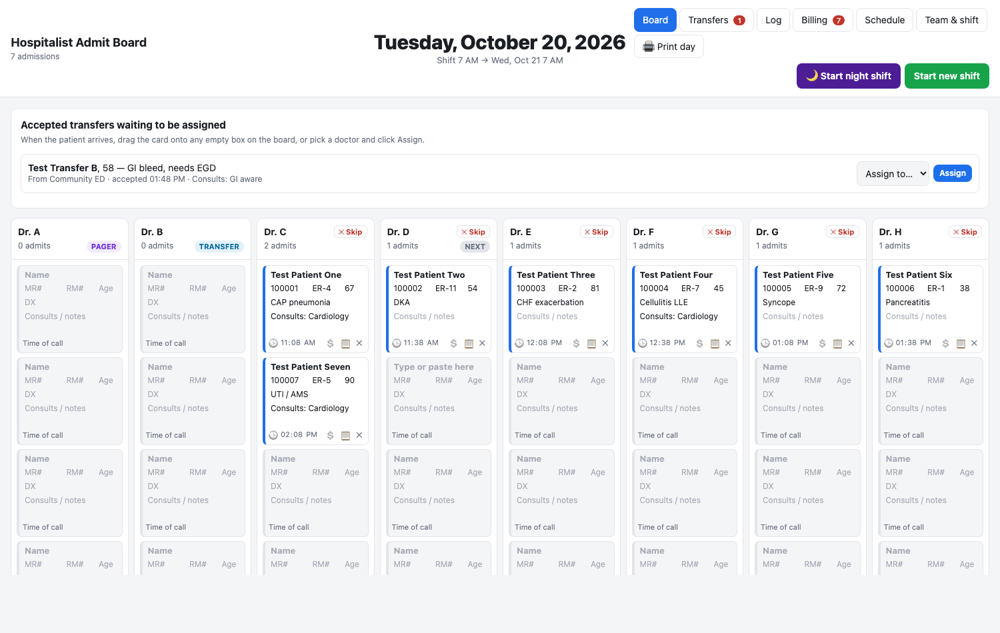

# Hospitalist Admit Board

**[▶ Live demo](https://munozmed2017-max.github.io/hospitalist-admit-board/#demo)**

A digital version of the paper admission sheet a hospitalist group uses to hand out ER admissions and transfers across a 24-hour shift.

> **Prototype, for demonstration only.** This app keeps everything in your own browser and has no logins, audit log or encryption. It is **not HIPAA compliant**. Do not enter real patient information. All names and numbers in the demo are made up.

## Why

Our group has 8 hospitalists rounding each morning. One of them carries the **pager** and hands out ER admissions in turn, and one takes **transfer** calls. Neither of them gets admissions in the rotation. At 7 PM a nocturnist takes over and admits to the whole team until 7 AM. We tracked all of this on a printed grid. This app turns that grid into a board that keeps track of the rotation for you.

## Features

**Admission board**
- One column per hospitalist. Every box is the same size and has the paper sheet's fields: Name, MR#, RM#, Age, DX, Consults/notes and Time of call.
- Click any box and type, or **paste the whole ER message**. It is split into name, age/sex, MRN, room, diagnosis, consults, ER doctor and level of care automatically.
- A round-robin rotation tracks who is up next. The pager and transfer doctors are left out of it, but can still take an admission themselves.
- **✕ Skip** a doctor who has too many patients or asked to be skipped. They get an X box, and the rotation passes over them once.
- 📋 copies a ready-to-send message for the admitting doctor.

**Transfers**
- Log each request with what the patient is coming for and which consultants are involved, then accept or decline it.
- When the patient arrives, drag the card onto any doctor's box, or pick a doctor from the list.

**Night shift**
- **🌙 Start night shift** asks for the night hospitalist(s) and who receives night admissions.
- Day admissions get a thick black frame, so the night admitter can see where their part starts.
- The night rotation goes through the whole team. Each night admission records which nocturnist admitted it.

**Billing**
- Every admission gets a billing sheet: patient, MRN, date of service, admission code (99221–99223, 99291, 99234–99236, or any other code), diagnosis and assigned doctor.
- Print the sheets or export them as CSV. A badge counts admissions that still need a code.

**Schedule**
- Pager / Transfer schedule for the Tuesday → Monday rotation. Paste it as you'd write it ("Tuesday smith/jones").
- Requests ("I'd like to be pager", "I can't work this day") wait for approval. "Someone is covering for me" changes the schedule right away.
- Starting a new shift sets that day's pager and transfer doctors on the board automatically.

**End of day**
- One sheet covers 7 AM to 7 AM the next day.
- **Print day** prints a landscape grid laid out like the paper form, plus the admission log, the transfers and the skips.

## Try it

- **Online:** [**Live demo with sample data**](https://munozmed2017-max.github.io/hospitalist-admit-board/#demo). Drop the `#demo` for an empty board.
- **Locally:** download `index.html` and open it in any browser. There's nothing to install. To load sample data, go to *Team & shift → Load demo data*.

Everything is one HTML file of plain HTML, CSS and JavaScript, with no libraries. Data is saved in the browser's `localStorage`.

## What a real deployment would need

Real use with patient data would need hosting with a signed BAA, a personal login for each user with two-factor sign-in and roles (rounders, nocturnists, secretaries who can only view and print, the medical director), encryption, audit logging, backups, and approval from the hospital's privacy and IT teams.

---

Built by Jhonatan with [Claude Code](https://claude.com/claude-code).
